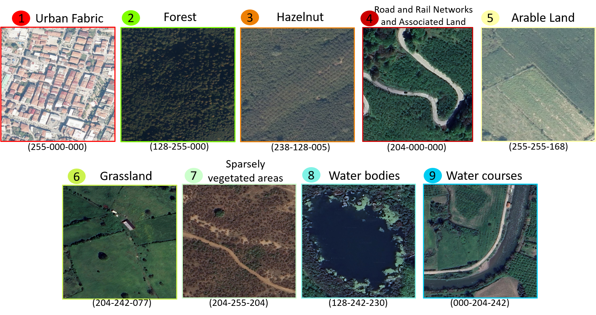
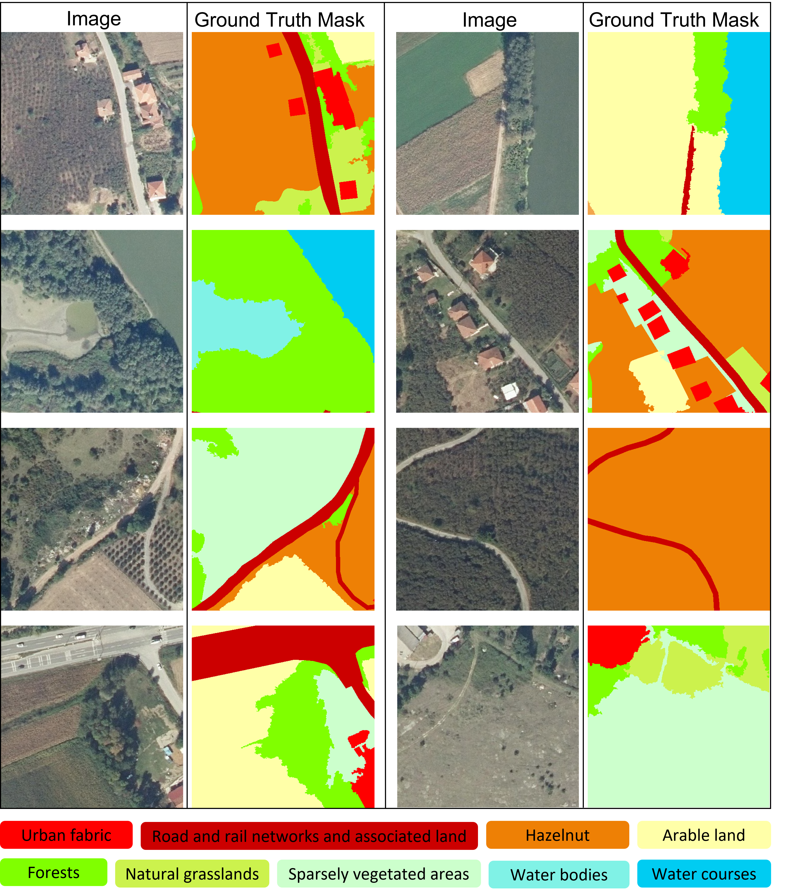
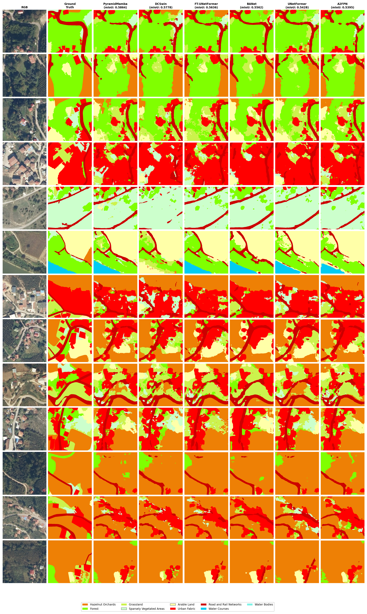

# VHR-LULC-Hazelnut

**VHR-LULC-Hazelnut** is a nine-class very high-resolution (VHR) aerial imagery benchmark dataset for land use and land cover (LULC) segmentation, derived from 0.25 m RGB aerial photographs of Sakarya Province, northwestern Türkiye. The dataset introduces a dedicated **hazelnut orchard** class alongside eight general LULC categories and provides a challenging benchmark for distinguishing hazelnut from spectrally similar woody vegetation.

---

## LULC Classes

Reference masks were produced by Object-Based Image Analysis (OBIA) in eCognition Developer, supported by field surveys, LPIS data, and OpenStreetMap. Nine classes were defined following the CORINE Land Cover nomenclature, with hazelnut orchards assigned a dedicated RGB code.

| Class | RGB Code |
|:------|:--------:|
| Hazelnut | 238–128–005 |
| Forest | 128–255–000 |
| Grassland | 204–242–077 |
| Sparsely Vegetated Areas | 204–255–204 |
| Arable Land | 255–255–168 |
| Discontinuous Urban Fabric | 255–000–000 |
| Road and Rail Networks | 204–000–000 |
| Water Courses | 000–204–242 |
| Water Bodies | 128–242–230 |

*Figure 2. Representative aerial photograph samples of the selected land cover classes.*

---

## Dataset

Image patches (512 × 512 px) and corresponding ground-truth masks were generated with a 64-pixel overlap between adjacent patches. Patches with excessive no-data regions were discarded. The remaining pairs were split into training, validation, and test sets.

| Study Area | Training | Validation | Test | Total |
|:----------:|:--------:|:----------:|:----:|:-----:|
| Akyazı | 1,070 | 271 | 247 | 1,588 |
| Karasu | 1,435 | 392 | 414 | 2,241 |
| Hendek | 1,610 | 318 | 345 | 2,273 |
| Karasu–Hendek | 2,337 | 402 | 376 | 3,115 |
| **Total** | **6,452** | **1,383** | **1,382** | **9,217** |

*Figure 3. Examples of RGB aerial image patches and their corresponding ground truth masks.*

---

## Benchmark Results

Seven deep learning semantic segmentation architectures — spanning convolutional, Transformer, hybrid, and state-space model families — were compared under a fixed experimental protocol. Loss function (CE, Focal, CE+Dice), optimizer (Adam, AdamW), and augmentation strategy were systematically varied while keeping the dataset and evaluation protocol constant.

**Best test-set performance per architecture (sorted by mIoU):**

| Model | Loss | Optimizer | Augmentation | OA | mF1 | mPrec | mRec. | mIoU |
|:------|:----:|:---------:|:-------------------:|:---:|:---:|:-----:|:-----:|:----:|
| PyramidMamba | CE | AdamW | No augmentation | 0.7647 | 0.7191 | 0.7257 | 0.7134 | **0.5864** |
| DCSwin | Focal | Adam | RBC+HF+RC+PadIfNeeded | 0.7541 | 0.7123 | 0.7176 | 0.7070 | **0.5778** |
| FT-UNetFormer | Focal | Adam | RBC+HF+RC+PadIfNeeded | 0.7467 | 0.7007 | 0.7072 | 0.6926 | **0.5636** |
| BANet | Focal | Adam | RBC+HF+RC+PadIfNeeded | 0.7419 | 0.6926 | 0.6996 | 0.6858 | 0.5562 |
| UNetFormer | Focal | Adam | RBC+HF+RC+PadIfNeeded | 0.7612 | 0.7065 | 0.7032 | 0.7109 | 0.5428 |
| A2FPN | Focal | Adam | RBC+HF+RC+PadIfNeeded | 0.7254 | 0.6793 | 0.6845 | 0.6741 | 0.5395 |
| MANet | Focal | Adam | RBC+HF+RC+PadIfNeeded | 0.7240 | 0.6730 | 0.6769 | 0.6691 | 0.5358 |

> **Abbreviations:** RBC = RandomBrightnessContrast · HF = HorizontalFlip · RC = RandomCrop · PadIfNeeded = Pad to fixed size

**Qualitative segmentation comparison of the six best-performing models on selected test tiles:**

*Columns follow the mIoU ranking. MAN = manually digitised ground truth. Swin-B-based models (PyramidMamba, DCSwin, FT-UNetFormer) produce more consistent class boundaries in heterogeneous scenes compared to ResNet-based architectures.*

---

## Citation

Please cite our paper if this dataset or the associated code is useful for your research.

*Citation will be added upon publication.*
